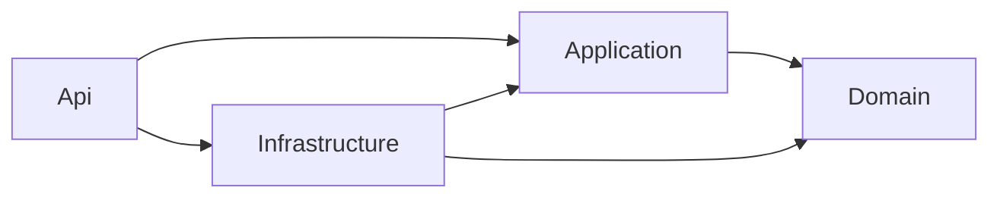

# FCG.UsersAPI

Microsserviço de usuários e autenticação do FIAP Cloud Games, Tech Challenge Fase 2, em **.NET 8**. Banco próprio PostgreSQL; JWT RS256; eventos por Outbox própria e MassTransit/RabbitMQ.

## Executar para demonstração — E15

Com Docker em execução, usando containers Linux, abra o terminal na pasta deste repositório e execute:

```bash
docker compose up --build -d
```

Aguarde `usersapi` ficar saudável em `docker compose ps -a`. Abra **[Swagger](http://localhost:5088/swagger)**. Login sintético inicial: **admin@fcg.local** / **Admin_Demo_2026!**. Banco, migrations, chaves JWT, administrador e fila são preparados automaticamente. Não exige SDK .NET ou arquivo `.env` no host.

**[Guia curto para executar e testar](docs/operacao/EXECUTAR-DEMONSTRACAO-DOCKER.md)** · **[Aula didática E15](docs/aprendizado/E15-EXECUCAO-SIMPLIFICADA-COM-DOCKER.md)** · **[Evidências E15](docs/evidencias/E15/README.md)**

Este ambiente inicia UsersAPI + PostgreSQL + RabbitMQ. O painel RabbitMQ está em [localhost:15672](http://localhost:15672), com `fcg_demo` / `Rabbit_Demo_2026!`. As credenciais são conhecidas e exclusivas da demonstração local; os acessos externos ficam em loopback. NotificationsAPI/Catalog/Payments serão integradas pelo grupo.

Para parar preservando dados e chaves, use `docker compose down`. Para continuar, repita o comando de início. O preparo não redefine a senha de um administrador existente.

## Estado da entrega

**E15 concluída localmente em 08/10/2026.** Execução normal e prova em cópia limpa com volumes novos aprovadas; retomada preservou dados, mensagens e chaves. Build sem erros/avisos e nove testes de compatibilidade administrativa aprovados. [Evidências E15](docs/evidencias/E15/README.md).

**E14 concluída localmente em 08/10/2026.** O roteiro final compila uma cópia limpa da fonte, publica a API com suas dependências e executa os quatro cards em ambiente novo. **476 testes aprovados: 109 unitários e 367 de integração**, sem falhas/ignorados; Release sem erros/avisos. [Evidência da execução](docs/evidencias/E14/README.md).

Cadastro público, administrativo e primeiro admin local confirmam conta/auditoria/evento juntos. O worker publica pendências em segundo plano com confirmação, mandatory, reserva por linha e retry. E13 demonstrou recuperação do broker, reinício, crash após envio e coordenação entre dois processos. Reentrega é possível e exige idempotência do consumidor.

Complemento do #55 concluído após a conferência dos cards: EventType nos logs, build sem erros/avisos e 15 casos pertinentes aprovados, incluindo a API publicada. Não foram adicionados casos ao total da suíte anterior. [Aula para a reunião](docs/aprendizado/AULA-REUNIAO-USERSAPI-CARDS-52-55.md).

Branch: feature/c12-persistencia-migration; base 27cfa9a (c11). **E11–E15 estão locais, sem commit/push**; um clone da base não contém essas alterações. Nenhum card foi encerrado/atualizado automaticamente.

## Por onde começar

| Objetivo | Material |
|---|---|
| Testar no Postman | [Collection e ambiente local](postman/README.md): 53 requisições, tokens automáticos, casos positivos/negativos e RabbitMQ opcional. |
| Preparar a reunião do grupo | [Aula resumida #52–#55](docs/aprendizado/AULA-REUNIAO-USERSAPI-CARDS-52-55.md): base, comunicação, evento e infraestrutura. |
| Entender o fechamento e a prova prática | [Guia didático E14](docs/aprendizado/E14-CONSOLIDACAO-E-PASSAGEM-PARA-O-GRUPO.md). |
| Executar sem os arquivos da máquina do Matheus | [Roteiro do zero](docs/operacao/EXECUTAR-USERSAPI-DO-ZERO.md). |
| Revisar o que atende #52–#55 e o que falta integrar | [Matriz de passagem](docs/planejamento/MATRIZ-PASSAGEM-CARDS-52-55-E14.md). |
| Integrar autenticação com Catalog | [Contrato JWT](docs/contratos/CONTRATO-JWT-E14.md). |
| Integrar o evento com Notifications | [UserCreatedEvent](docs/contratos/CONTRATO-USERCREATED-E11.md) e [configuração/topologia](docs/contratos/CONFIGURACAO-PUBLICADOR-E12.md). |
| Investigar pendências do publicador | [Recuperação operacional](docs/operacao/RECUPERAR-PENDENCIAS-OUTBOX.md). |
| Conferir resultados | [Evidências E14](docs/evidencias/E14/README.md) e [índice completo](docs/README.md). |

## Pré-requisitos para desenvolvimento e testes

Git, SDK .NET 8.0.423/patch compatível com global.json e PowerShell 7.4+ para os roteiros. Docker Desktop com engine Linux em execução para os testes que criam PostgreSQL/RabbitMQ.

A conferência automática não precisa de .env.usersdb, container de desenvolvimento ou PEMs pessoais. Para executar HTTP manualmente: banco próprio com migrations aplicadas, conexão externa e par RSA explícito; seguir o roteiro do zero.

## Conferência completa da E14

```powershell
.\scripts\Verificar-PassagemE14.ps1
```

Cria uma cópia nova em TestResults/E14 sem bin/obj/segredos; restore/build Release; publish; SQL idempotente; unitários e toda integração. A nova prova executa a DLL publicada em Kestrel, com banco/broker/chaves novos, três cadastros, seis logs, sessão/permissões e três eventos na fila. Não executa Catalog/Notifications nem envia e-mail.

Saídas locais: passagem-e14.json, TRX, manifesto de fonte e migrations-users-e14.sql. Os containers/chaves das provas são descartáveis; as cópias de fonte/resultados são conservadas para inspeção, ignoradas pelo Git.

## Compilar e testar diretamente

```powershell
dotnet restore FCG.Users.sln
dotnet build FCG.Users.sln -c Release --no-restore
dotnet test tests/FCG.Users.UnitTests -c Release --no-build --no-restore
dotnet test tests/FCG.Users.IntegrationTests -c Release --no-build --no-restore
```

Unitários não exigem Docker. Integração usa PostgreSQL 16-alpine e RabbitMQ por digest em Testcontainers. O teste E14 publica sua própria pasta quando não recebe FCG_E14_PUBLISHED_API do runner.

Provas específicas disponíveis:

```powershell
.\scripts\Verificar-PublicadorE12.ps1
.\scripts\Verificar-RecuperacaoE13.ps1
```

São 46 casos específicos E12 e cinco E13, também incluídos na suíte completa. [Roteiros](scripts/README.md).

## Operações HTTP

| Rota | Permissão e comportamento |
|---|---|
| GET /health | Público; vida do processo, não prontidão de banco/broker. |
| POST /api/v1/usuarios | Público; perfil imposto Usuario; 201/400/409. |
| POST /api/v1/auth/login | Público; access RS256, refresh e dados básicos do usuário. |
| POST /api/v1/auth/refresh | Público; substitui o par com dados/perfil atuais. |
| POST /api/v1/auth/logout | Bearer; revoga todos os refreshs ativos do sub. |
| GET /api/v1/usuarios/{id} | Titular ou Administrador. |
| PUT /api/v1/usuarios/{id} | Titular ou Administrador; nome/e-mail/nascimento. |
| POST /api/v1/usuarios/administradores | Administrador; perfil imposto Administrador. |
| PUT /api/v1/usuarios/{id}/perfil | Administrador; perfil existente. |
| DELETE /api/v1/usuarios/{id} | Administrador; inativação lógica. |

Nos cadastros, X-Correlation-ID opcional é um único UUID não vazio com hífens. É devolvido/gerado e preservado no evento; não é autenticação ou idempotência HTTP. [Exemplos HTTP](src/FCG.Users.Api/FCG.Users.Api.http).

DTO de usuário tem sete campos, sem CPF/nascimento/hash/senha/tokens. As quatro auditorias são cadastro, edição, troca de perfil e inativação; alteração e log confirmam juntos. Repetição idêntica não duplica log.

Access padrão: 15 minutos; refresh: hash/7 dias. Logout, troca de perfil e inativação afetam sessões renováveis/novas emissões; JWT anterior mantém suas claims até expirar, com tolerância de 30 segundos. A privada fica somente em Users; Catalog valida com pública confiável, issuer/audience/kid e autorização próprios.

## Banco, administrador e publicação

Migrations: 20261004145013_CriacaoInicialUsers e 20261007023803_OutboxUserCreated. Startup não aplica migrations, transfere contas ou gera eventos retroativos.

--inicializar-admin-local é um modo explícito, restrito a Development e banco loopback, sem HTTP/RSA. Preserva um administrador já existente; não redefine senha. O roteiro do zero explica a preparação.

Outbox__Enabled=false por padrão. Mesmo desabilitado, cadastro grava a intenção. Quando habilitado, exige configuração RabbitMq externa e fila/bindings provisionados. O produtor não cria a fila de Notifications. Confirmação/mandatory não comprovam consumo ou e-mail.

A Outbox conserva nove campos. Retry é espera geral do worker; NextAttemptAt/LastErrorCode continuam proposta opcional sem decisão e não foram aplicados.

## Organização

| Projeto/pasta | Responsabilidade |
|---|---|
| Dockerfile / compose.yaml / infra/demo | Imagens, serviços locais, volumes, ordem de preparação e topologia RabbitMQ. |
| tools/FCG.Users.DemoSetup | Job explícito de demonstração; chaves, migrations e primeiro administrador, sem host HTTP. |
| Api | HTTP, JWT/policies, DTOs, correlação e modo CLI. |
| Application | Casos de uso, interfaces e contrato UserCreatedEvent. |
| Domain | Regras de usuário, perfil, token e auditoria. |
| Infrastructure | PostgreSQL, transações, Outbox, worker/transporte, migrations e hash/RSA. |
| UnitTests | Regras/coordenação com substitutos. |
| IntegrationTests | HTTP/segurança/banco/broker, recuperação e API publicada. |
| tools/FCG.Users.MessagingProof | Prova E10 separada usando o contrato de Application. |
| scripts / docs | Reprodução, aprendizado, contratos, operação e evidências. |



Não há dependência de projeto no monólito ou na DLL Notifications. O record conserva o namespace/URN de integração para compatibilidade. Versões em Directory.Packages.props; EF em .config/dotnet-tools.json.

## Continuidade do projeto

O plano original E01–E14 está concluído. A E15 acrescenta Dockerfile, Compose local de Users e preparação automática para facilitar a avaliação. As ações seguintes são revisão/envio das mudanças quando solicitado e validação conjunta com Catalog/Notifications/Payments, ambiente das quatro APIs e Kubernetes. [Matriz com próximos responsáveis](docs/planejamento/MATRIZ-PASSAGEM-CARDS-52-55-E14.md).

A revisão local de Notifications é 78b512477298cb9b37dbfe38504030d9c3d09a51, a mesma referência da E10. Tem consumidor compatível e envio simulado em console; Inbox/envio real precisam de evidência própria. A E14 não repetiu a execução conjunta do consumidor.

Os antigos docs/scripts das primeiras entregas não estavam presentes no início da E11. O material atual foi produzido para esta implementação; não representa restauração automática do histórico.
